<p align="center"></p>

<div align="center">

# 🛰️ ARTHIS.land Relay

**A lightweight, zero-dependency real-time relay server for [ARTHIS.land](https://arthis.land) — “The Wall.”**

Rooms of 2–4 players, plain **TCP** _and_ **WebSocket** on a single port, written entirely in the Python standard library.


</div>

---

## Overview

`arthis-land-relay` is the multiplayer backend behind **ARTHIS.land**, the Unity “vertical city” experience. It relays game state between players in a room without any game logic of its own — clients stay authoritative, the server just moves messages fast and cleanly.

It speaks two transports on the **same port** and auto-detects which one a client is using:

- **Plain TCP** — for standalone (desktop/mobile) Unity builds
- **WebSocket** — for WebGL builds running in the browser (handshake + framing implemented from scratch, no libraries)

The entire server is a single file (`relay_server.py`) with **no third-party dependencies** — just the Python standard library.

## Features

- 🎮 **2–4 players per room**, each assigned a stable numeric ID (`1`–`4`)
- 🔀 **Dual transport** — TCP and WebSocket transparently share one listener
- 🧵 **Threaded** — one lightweight thread per connection, thread-safe rooms
- 🔢 **Simple room codes** — 4-digit numeric codes for host/join matchmaking
- 💓 **Keepalive aware** — `PING` frames are absorbed; OS-level `SO_KEEPALIVE` drops dead peers
- ☁️ **Cloud-ready** — reads `$PORT`, ships with a `Dockerfile` and `Procfile`
- 🪶 **Tiny footprint** — pure stdlib, `python:3.11-slim` image

## Protocol

Signalling is line-based text. Once a room is live, game data is relayed verbatim with a sender prefix.

**Client → Relay**

| Message      | Meaning                                             |
| ------------ | --------------------------------------------------- |
| `HOST:CODE`  | Create a room (`CODE` = 4-digit number)             |
| `JOIN:CODE`  | Join an existing room                               |
| `STATE:…`    | Game state — relayed to everyone else in the room   |
| `NAME:name`  | Player name — relayed to others                     |
| `SCENE:scene`| Scene sync — relayed to others                      |
| `PING`       | Keepalive — absorbed by the relay, never forwarded  |

**Relay → Client**

| Message                     | Meaning                                          |
| --------------------------- | ------------------------------------------------ |
| `WAITING`                   | Host is waiting for the first joiner             |
| `CONNECTED:<id>[,<id2>,…]`  | You are player `<id>`; existing player IDs follow|
| `JOINED:<id>`               | A new player joined                              |
| `LEFT:<id>`                 | A player disconnected                            |
| `BUSY` / `NOTFOUND` / `FULL` / `INVALID` | Error responses                     |

Forwarded game messages arrive as `P:<sender_id>,<original_message>`.

## Quick start

```bash
# Requires Python 3.11+  (no pip install needed — stdlib only)
python relay_server.py               # listens on 0.0.0.0:7777
python relay_server.py --port 9000   # custom port
```

You should see:

```text
[Relay] Listening on 0.0.0.0:7777  (TCP + WebSocket)
```

## Deployment

The server binds `0.0.0.0` and honors the `PORT` environment variable, so it runs as-is on most platforms.

| Platform  | How                                                          |
| --------- | ----------------------------------------------------------- |
| **Docker**| `docker build -t arthis-land-relay . && docker run -p 7777:7777 arthis-land-relay` |
| **Railway**| Start command: `python relay_server.py` (`PORT` auto-injected) |
| **Render**| Start command: `python relay_server.py --port $PORT`        |
| **Fly.io**| `fly launch && fly deploy`                                   |

`requirements.txt` is intentionally empty — it exists only so Python buildpacks detect the project.

## Connecting from Unity

1. Open a socket to the relay (`ws://…` for WebGL, raw TCP for standalone builds).
2. Send `HOST:1234` to create a room, or `JOIN:1234` to join one.
3. Wait for `CONNECTED:<id>` to learn your player ID.
4. Send `STATE:…` / `NAME:…` / `SCENE:…` each tick; read inbound `P:<id>,…` messages and apply them to the matching remote player.

## How it works

```text
        ┌─────────────┐        HOST:1234         ┌──────────────┐
        │  Unity P1   │ ───────────────────────▶ │              │
        │ (WebGL/WS)  │ ◀─── CONNECTED:1 ─────── │              │
        └─────────────┘                          │    Relay     │
                                                 │  (rooms +    │
        ┌─────────────┐        JOIN:1234         │   threads)   │
        │  Unity P2   │ ───────────────────────▶ │              │
        │ (TCP build) │ ◀─── CONNECTED:2,1 ───── │              │
        └─────────────┘                          └──────┬───────┘
                                                        │
             P:2,STATE:… ◀───── broadcast to others ────┘
```

Each connection runs on its own thread. A `Room` tracks its players behind a lock; when a player disconnects, everyone else receives `LEFT:<id>`, and the room is torn down once empty.

## Project layout

```text
arthis-land-relay/
├── relay_server.py    # the entire server (stdlib only)
├── Dockerfile         # python:3.11-slim image
├── Procfile           # web: python relay_server.py --port $PORT
└── requirements.txt   # empty — marks this as a Python project
```

---

<div align="center">
Part of the <b><a href="https://arthis.land">ARTHIS</a></b> universe · built by <a href="https://github.com/akversebusiness-beep">@akversebusiness-beep</a>
</div>
